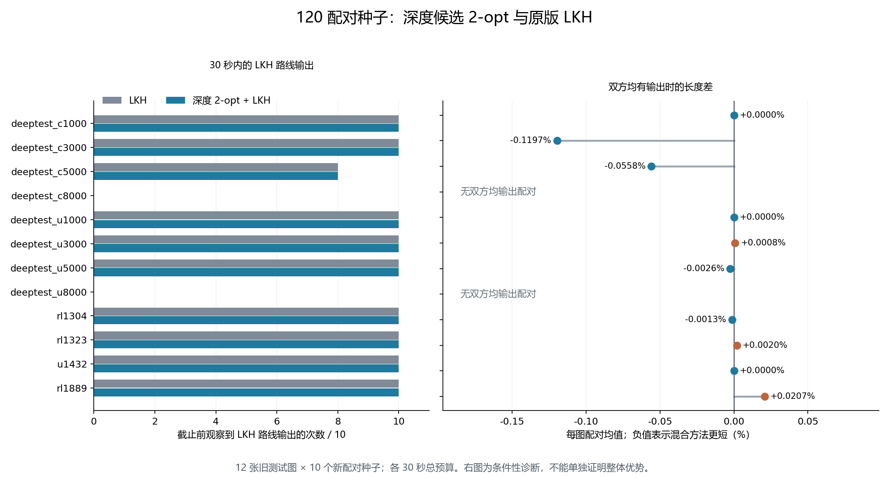

# 120 配对种子实验结果

**这版尚不能认定稳定击败经典 LKH。**

本轮运行“贪心初解 → 深度模型选择候选 2-opt → 路线池 → 原版 LKH”，对比同一个原版 LKH 的正常初始化。12 张图，每图 10 个新配对种子，共 240 次运行；每次 30 秒总墙钟，所有在线开销计入。没有执行量子选择。

| 比较范围 | 平均路线变化，负值更短 | 胜／平／负 |
|---|---:|---:|
| 双方均有 LKH 输出，98 配对 | **−0.015599%** | **23／48／27** |
| 全部 120 配对 | −18.120579% | 45／48／27 |

98 配对的事后条件统计区间为 **[−0.033624%，+0.001498%]**，跨过零。这是按地图重采样的机制诊断，不能单独推广成整体优势。

总体 18.12% 的较大改善主要来自 22 组双方的 LKH 都未及时导出路线：普通组退回编号顺序路线，混合组已有贪心和局部改进路线。它说明限时下可交付路线更好，不能解释为 LKH 精修质量提高了 18.12%，也不能归因于深度模型本身。

按用户要求，前 136 次采用四路，剩余 104 次采用八路不同物理核心；4 个半配对在原核心补完。原有结果与冻结文件均保留，调度变更另有记录。每对双方仍在同一个核心依次运行。所有 240 次运行正常结束，独立核验最终路线 240 条、在线检查点 2668 条、里程碑 480 条，零错误。

[详细报告](analysis/中文结果报告.md) · [独立复核摘要](独立复核摘要.md)（逐配对、逐图数据文件未上传，汇总表见详细报告）

